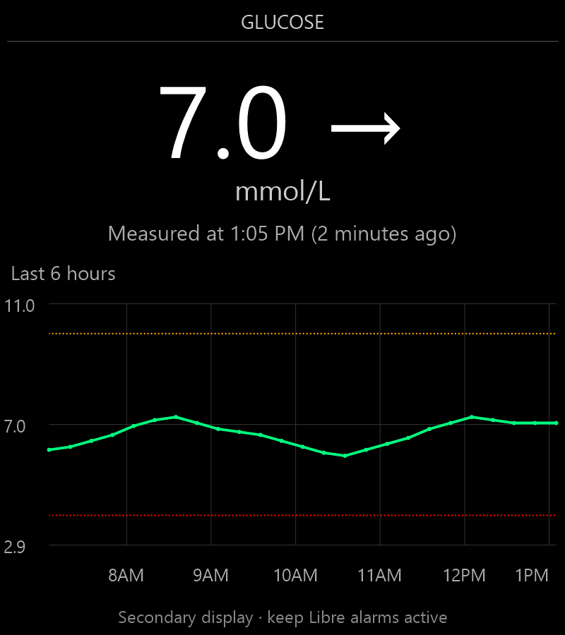
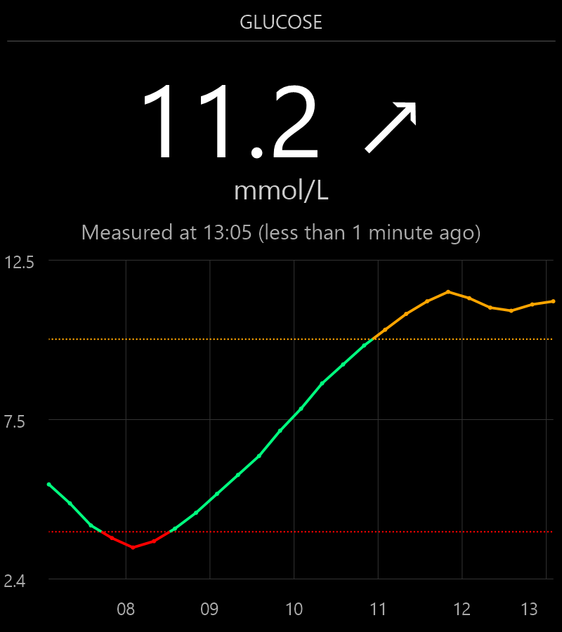

# MMM-Libre2

A MagicMirror² module for displaying glucose readings and history through an **unofficial LibreLinkUp cloud connection**. It does not connect directly to a sensor or read the Libre phone app's local files.

**Status:** experimental. Automated tests use synthetic readings and mocked network responses. A real Abbott account and an installed MagicMirror have not been used to validate this project. Abbott can change its private API at any time; completing the official app setup does not guarantee this integration will work.

This is a secondary information display, not a medical device or glucose alarm. Follow the instructions for the approved Libre app/reader for treatment decisions and keep its alarms active.

## Features

- Current glucose in mmol/L or mg/dL and a trend arrow.
- One status line: `Measured at 1:05 PM (2 minutes ago)` or `(less than 1 minute ago)`.
- Optional 12-hour clock without a leading zero, or a 24-hour clock.
- History graph with hourly gridlines and local clock-hour labels (for example `1PM` in 12-hour mode or `13` in 24-hour mode). If labels would overlap, every other label is hidden; labels are thinned again if needed for very narrow graphs. All hourly gridlines remain visible.
- Configurable dimensions, visual thresholds, named colors, and footer visibility.
- Dotted horizontal guides at `minMmol` and `maxMmol`, using `underColor` and `overColor`.
- Red below the minimum, springgreen within the range, orange above the maximum by default.
- Stale and cached-data notices; gaps over 20 minutes are not connected.

## Display mockups

These two illustrations use **invented readings**, not personal health data. They approximate the expected module appearance on MagicMirror's black background; they are not screenshots from a live installation or image-based regression tests. Fonts, spacing, and wrapping depend on the MagicMirror theme, screen, and configured dimensions. Automated tests check behavior and drawing commands rather than comparing screenshots.

### Example 1: in-range reading

A steady 7.0 mmol/L reading, green history, a 12-hour clock without a leading zero, and the secondary-display footer enabled.



Relevant settings (inside the module's `config`):

```javascript
width: 400,
height: 420,
timeFormat: 12,
minMmol: 3.9,
maxMmol: 10,
underColor: "red",
overColor: "orange",
withinRangeColor: "springgreen",
showSecondaryDisplayText: true
```

### Example 2: history crossing both thresholds

An 11.2 mmol/L reading with a rising trend, a 24-hour clock, and both the history heading and footer hidden. The graph expands into the freed space. Earlier history dips below 3.9 (red), returns to the configured range (green), then rises above 10 (orange). The large current number remains white; configured threshold colors apply to the graph line and points.



Use the first example's settings with:

```javascript
timeFormat: 24,
showGraphLabel: false,
showSecondaryDisplayText: false
```

Both examples use `units: "mmol/L"`, `showGraph: true`, and `graphHours: 6`. Measurements are fresh in these illustrations, so stale/cached warnings are absent. Actual history comes from the service; the module does not generate these sample readings.

## How the pieces connect

```text
Libre sensor -> official Libre phone app -> Abbott cloud
                                              |
                                    LibreLinkUp follower account
                                              |
                                   MMM-Libre2 server helper
                                              |
                                      MagicMirror display
```

You need an active supported sensor, a compatible phone, internet access, an email address for a follower account, and a computer with a screen for MagicMirror. A Raspberry Pi with a desktop operating system or a Linux desktop is a suitable starting point. Windows instructions are also provided below. A physical mirror is optional.

The module has no third-party npm dependencies; MagicMirror itself has dependencies installed separately. A paid developer account is not required.

## 1. Set up the official Libre phone app

1. Use Abbott's [country selector](https://www.freestyle.abbott/) to identify the official app and compatible phones for the sensor and country. App names and features vary by region.
2. Install the indicated official app from Google Play or Apple's App Store. Sign in or create the requested Libre account and complete verification and consent.
3. Follow the app's instructions to start the sensor. If a sensor is already active, continue using that setup rather than pairing it again for this project.
4. Confirm current readings appear in the official app and that the phone has internet access. Allow any permissions and background operation required by Abbott.

Do not continue until the official phone setup works. This module cannot repair a sensor pairing or make a phone upload readings faster.

## 2. Create a LibreLinkUp follower connection

The mirror logs in as a **follower**, rather than as the sensor owner's account. Prefer a separate follower account dedicated to the mirror to reduce competing logins with other tools.

1. In the sensor owner's official app, open its menu and select **Share** or **Connected Apps**.
2. Select **LibreLinkUp**, then **Connect/Manage** and **Add Connection**. Invite the email address intended for the follower.
3. Open that invitation and install the official **LibreLinkUp** app using the app-store link. A separate compatible phone can be used for this step.
4. Create the follower account using the invited email. Select the actual country/region, verify the email, and complete the requested consent.
5. Accept the sharing invitation in LibreLinkUp. Check that the intended person's readings appear before configuring the mirror.
6. After verification, avoid keeping that dedicated follower account actively polling in another app. Keep the sensor owner's main Libre app running normally.

Menu names may vary. See Abbott's [LibreLinkUp getting-started guide](https://www.librelinkup.com/articles/getting-started) for the official process and regional compatibility limitations. This module currently implements a legacy private API; some account or protocol changes may prevent login. Do not repeatedly change the API version or force logins to bypass a rejection.

## 3. Install the computer software

If starting with a Raspberry Pi, first install a current desktop edition of [Raspberry Pi OS using Raspberry Pi Imager](https://www.raspberrypi.com/software/), complete its first-boot setup, connect to the internet, and open Terminal. Use a regular user account, not root. On another computer, start from a working desktop operating system and open its terminal.

### Install Git and Node.js

- **Windows:** install [Git](https://git-scm.com/downloads) and a supported [Node.js](https://nodejs.org/en/download) installer for the computer's architecture. Keep the options to add them to PATH. Open a new PowerShell window afterward.
- **Raspberry Pi/Linux:** install Git with the operating system's package manager. On Raspberry Pi OS/Debian/Ubuntu: `sudo apt update`, then `sudo apt install git`. Install Node.js using the appropriate instructions from the [official Node download page](https://nodejs.org/en/download), selecting the computer's architecture. Avoid an outdated distribution Node package.

Node includes npm. In a new terminal verify all three commands work:

```text
node --version
npm --version
git --version
```

This module needs Node 20 or later, but **the chosen MagicMirror release may require a newer version**. Check [MagicMirror releases](https://github.com/MagicMirrorOrg/MagicMirror/releases) and its `package.json` engines field before installing. Node 24 is a suitable starting choice if supported by that release and the operating system. A missing command means installation/PATH must be fixed before continuing.

### Install MagicMirror²

Choose a folder for the installation, such as the home directory. Run these commands one at a time:

```sh
git clone https://github.com/MagicMirrorOrg/MagicMirror.git
cd MagicMirror
node --run install-mm
```

Installation can take several minutes. Let it finish successfully. Create the initial configuration **only for a new installation**:

Linux/Raspberry Pi:

```sh
cp config/config.js.sample config/config.js
node --run start
```

Windows PowerShell:

```powershell
Copy-Item config/config.js.sample config/config.js
node --run start:windows
```

Confirm the default mirror appears. Stop it with Ctrl+C in its terminal before continuing. On a Linux desktop using X11, use `node --run start:x11` if the default Wayland launcher does not apply. Keep MagicMirror's default local-only network settings; this guide does not require remote access.

These are the current upstream commands. For a different release or installation error, use its [official installation guide](https://docs.magicmirror.builders/getting-started/installation.html). Do not overwrite an existing configuration with the sample.

## 4. Install MMM-Libre2

Download this repository using GitHub's **Code -> Download ZIP**. Extract it. Rename the extracted repository folder (which may end in `-main`) to exactly `MMM-Libre2`, then move that folder into `MagicMirror/modules`.

The result must look like this, without an extra nested folder:

```text
MagicMirror/
  modules/
    MMM-Libre2/
      MMM-Libre2.js
      MMM-Libre2.css
      node_helper.js
      lib/
        client.js
      package.json
```

Alternatively, clone the published repository into that folder. Replace `YOUR_GITHUB_USERNAME` with the repository owner's GitHub username:

```sh
cd /path/to/MagicMirror/modules
git clone https://github.com/YOUR_GITHUB_USERNAME/MMM-Libre2.git MMM-Libre2
```

`/path/to/MagicMirror` is a placeholder for the actual installation folder. No npm install is needed inside this module. Do not install a package called `node_helper`; MagicMirror supplies that API.

## 5. Create the private server configuration

Credentials belong **outside the repository and outside MagicMirror's web-served folder**. The module reads `~/.config/MMM-Libre2/config.json` under the operating-system user running MagicMirror. Never commit this private file.

### Linux/Raspberry Pi

```sh
mkdir -p ~/.config/MMM-Libre2
chmod 700 ~/.config/MMM-Libre2
nano ~/.config/MMM-Libre2/config.json
```

Paste the JSON below and replace the email/password placeholders with the follower account credentials. Save in nano with Ctrl+O, Enter, then exit with Ctrl+X.

### Windows PowerShell

```powershell
$libreSettingsFolder = Join-Path $env:USERPROFILE '.config/MMM-Libre2'
New-Item -ItemType Directory -Force -Path $libreSettingsFolder
notepad (Join-Path $libreSettingsFolder 'config.json')
```

Paste the same JSON and save. Ensure the filename is `config.json`, not `config.json.txt`. In File Explorer, use the file's **Properties -> Security** settings to limit access to the account running MagicMirror and necessary system administrators.

### Private JSON contents

```json
{
  "email": "YOUR_FOLLOWER_EMAIL",
  "password": "YOUR_FOLLOWER_PASSWORD",
  "region": "",
  "apiVersion": "4.17.0",
  "updateInterval": 60000
}
```

Leave `region` empty for global discovery. If a known regional endpoint is needed, supply its code (for example `ca` for Canada). This is not a country selector for creating an account.

On Linux/Raspberry Pi, finish with:

```sh
chmod 600 ~/.config/MMM-Libre2/config.json
```

The file is plaintext, protected by operating-system permissions. Use valid JSON: double quotes, no comments, and no trailing comma. A quote or backslash inside a password must be JSON-escaped.

For a custom path, set the environment variable `MMM_LIBRE2_CONFIG` on the server process before starting MagicMirror. The default requires no environment-variable setup. An autostart service must run as the same user or be configured with the correct private path.

## 6. Add the module to the mirror

Open `MagicMirror/config/config.js` in a text editor. Locate the existing `modules: [` array and add the object below between its brackets, separated from other module objects by a comma. Do not replace the entire file with this snippet.

```javascript
{
  module: "MMM-Libre2",
  position: "top_right",
  header: "Glucose",
  config: {
    units: "mmol/L",
    timeFormat: 24,
    overColor: "orange",
    underColor: "red",
    withinRangeColor: "springgreen",
    staleAfterMinutes: 10,
    showGraph: true,
    showGraphLabel: true,
    graphHours: 6,
    width: 320,
    height: 360,
    minMmol: 3.9,
    maxMmol: 10,
    showSecondaryDisplayText: true
  }
},
```

Never place email, password, tokens, or patient identifiers in this browser-side configuration. From the **MagicMirror directory**, check the configuration and start:

```sh
node --run config:check
```

Then run `node --run start` on Linux/Wayland, `node --run start:x11` on Linux/X11, or `node --run start:windows` on Windows. Leave the terminal process running. Ctrl+C stops it. Automatic startup is optional and not required by this module; establish a working manual installation first.

## 7. Check the complete connection

1. Allow a polling cycle (normally at least 60 seconds) and check that a reading appears.
2. Compare units, value, trend, and measurement time with the official Libre app.
3. Check that new sensor readings eventually appear; a successful fetch does not make an old measurement fresh.
4. Temporarily disconnect the mirror computer's network. After a failed poll the last reading should be labeled as cached; its measurement age continues increasing and the stale notice appears after the configured age.
5. Restore the connection and allow retries to complete. Polling backs off after failures, so recovery may take longer than one minute.

Only history available from Abbott is displayed; selecting 12 hours cannot create missing history. Current time and measurement time use the mirror computer's clock/timezone.

## Configuration

Browser config:

| Option | Default | Meaning |
|---|---|---|
| units | `mmol/L` | Use `mg/dL` to display whole-number mg/dL |
| timeFormat | `24` | Measurement time: `24` for 00:00–23:59 or `12` for a clock with AM/PM and no leading zero on the hour, such as 1:05 PM (localized to your browser). Graph labels also use this clock format, with no space before AM/PM in 12-hour mode and zero-padded hours in 24-hour mode. Gridlines align to the hour in the mirror computer’s timezone. |
| staleAfterMinutes | `10` | Age of sensor reading that triggers the stale warning |
| showGraph | `true` | Display available history |
| showGraphLabel | `true` | Show “Last X hours” above the graph; set to `false` to hide it |
| graphHours | `6` | Graph window, limited to 1–12 hours |
| width | `320` | Module content width in pixels; positive number |
| height | `360` | Module content height in pixels; positive number |
| minMmol | `3.9` | Lower graph threshold in mmol/L; uses `underColor` below it |
| maxMmol | `10` | Upper graph threshold in mmol/L; uses `overColor` above it |
| overColor | `orange` | CSS named color for graph segments and dots above the maximum and the dotted maximum guide |
| underColor | `red` | CSS named color for graph segments and dots below the minimum and the dotted minimum guide |
| withinRangeColor | `springgreen` | CSS named color within the range, including its boundaries |
| showSecondaryDisplayText | `true` | Show the bottom “Secondary display · keep Libre alarms active” text; set to `false` to hide it |

Dimensions apply to the module content, excluding MagicMirror's optional header. Small dimensions allow scrolling rather than clipping the content. The graph expands into available height. Hiding `showGraphLabel` or `showSecondaryDisplayText` removes that item and its margins; the graph automatically takes the freed space within the configured module height. A minimum graph height of 80 pixels is retained, so very small modules may scroll. Invalid dimensions fall back to the defaults.

Use CSS color names such as `orange`, `red`, `springgreen`, `limegreen`, or `cyan`. See the [W3Schools CSS color names reference](https://www.w3schools.com/cssref/css_colors.php) for the available names and color previews. Defaults are `red`, `orange`, and `springgreen`.

Both thresholds are always configured in mmol/L, even when displaying mg/dL. They control graph colors and dotted horizontal reference lines, not alarms. The automatically scaled graph axis includes both thresholds as well as all available readings so both guides stay visible. The minimum must be positive and the maximum must exceed it; invalid settings show a notice and use 3.9–10 mmol/L. Segments crossing a threshold change color at the crossing.

Server JSON:

| Option | Default | Meaning |
|---|---|---|
| email, password | Required | Dedicated LibreLinkUp follower credentials |
| region | empty if omitted | Leave empty for global discovery; `ca` is the Canadian endpoint |
| apiVersion | `4.17.0` | Legacy protocol version header, configurable for compatibility |
| updateInterval | `60000` | Poll interval in ms, minimum 60 seconds |
| patientId | not set | Required when this follower has more than one connection |

The module never chooses an arbitrary person when multiple connections exist. Use a follower with just your connection, or supply the intended `patientId` from the account's connection data. All displayed instances use the one server account; separate accounts per instance are not implemented.

## Troubleshooting

| Symptom | Check |
|---|---|
| `node`, `npm`, or `git` is not recognized | Install the required tool, then open a new terminal and verify PATH. |
| MagicMirror does not start | First confirm the default mirror works, check its supported Node version, and use the correct OS launcher. |
| Module is missing | Check folder name/nesting, the module entry in the `modules` array, and `node --run config:check`. |
| Cannot load server settings | Check the private file path, user account, permissions, valid JSON, and nonempty follower credentials. |
| No shared connection | Verify the invitation was accepted and readings appear in the official LibreLinkUp follower app. |
| HTTP 401/403 | Verify follower login/consent and upstream protocol compatibility. Repeated restarts are not a fix. |
| HTTP 429 | Wait for the cooldown, at least 15 minutes. Use a dedicated follower and avoid competing clients. |
| Multiple connections | This module will not choose arbitrarily. Use a follower with one connection or supply its intended `patientId` privately. |
| Old readings | Check the sensor owner's app and phone internet connection; compare measurement times. |
| History unavailable | Current readings can remain available while the optional graph endpoint fails. |
| Wrong displayed time | Check the computer's clock and timezone. FactoryTimestamp is interpreted as UTC. |

The client keeps its authentication token in memory, retries authentication once on HTTP 401, and backs off on repeated failures. Restarting clears cached readings and tokens. Changing private server settings requires a restart.

## Privacy and reporting problems

The repository contains placeholders and synthetic test data, not user credentials or real glucose records. Runtime settings are intentionally separate. `.gitignore` excludes common private settings, logs, environment files, and caches, but cannot protect secrets pasted into tracked source files or previous commits.

The mirror screen and its web UI contain health data. Keep access private. This module does not add web authentication; do not expose MagicMirror directly to the internet. Before sharing an issue, remove names, emails, credentials, tokens, patient IDs, screenshots with readings, and raw API responses. Do not upload the private configuration or a copy of the entire configured MagicMirror installation.

If a credential is published, revoke/change it immediately. Deleting the visible file alone does not remove it from Git history.

## Development and automated tests

From the module directory, with Node installed:

```sh
npm test
```

No account, sensor, network access, MagicMirror installation, or npm dependency installation is needed for the mocked tests. They cover login/redirect behavior, timestamps, unit conversion, graph colors and crossings, dimensions, status wording, clock formats, and hourly labels. GitHub Actions runs this suite on Node 22 and 24 after pushes and pull requests. This is not evidence of current live API compatibility or actual MagicMirror layout testing.

## Publish this project on GitHub

1. Sign in to [GitHub](https://github.com/) or create an account.
2. Create an empty repository called `MMM-Libre2`. Do not add a generated README or license during creation; the prepared project already contains both files.
3. Upload **the contents** of the `MMM-Libre2` folder to the repository root, not the outer ZIP or a nested project folder. Include `.gitignore` and `.github/workflows/test.yml`; some file pickers hide dotfiles. Git is recommended to ensure these are included.
4. Review the files before publishing. Only the example configurations belong in the repository. No private account configuration is needed for publishing or CI.

For Git, open a terminal **inside this module folder**, replace the username placeholder below, and run:

```sh
git init
git add .
git status --short
git diff --cached
```

Review that staged diff for private data, then:

```sh
git commit -m "Initial MMM-Libre2 module"
git branch -M main
git remote add origin https://github.com/YOUR_GITHUB_USERNAME/MMM-Libre2.git
git push -u origin main
```

Git may request your identity and GitHub authentication. Configure the desired author identity on your computer; use a GitHub-provided no-reply email if you do not want a personal email in commit metadata. No author identity or personal repository URL is preconfigured in this project. Follow [GitHub's authentication instructions](https://docs.github.com/en/authentication) if prompted.

`private: true` in `package.json` prevents accidental npm publication; it does not prevent a public GitHub repository. This project is licensed under the [MIT License](LICENSE).

## License

[MIT License](LICENSE). Copyright (c) 2026 MMM-Libre2 contributors.

## References

- [MagicMirror installation](https://docs.magicmirror.builders/getting-started/installation.html)
- [MagicMirror releases and runtime requirements](https://github.com/MagicMirrorOrg/MagicMirror/releases)
- [MagicMirror module API](https://develop-docs.magicmirror.builders/module-development/core-module-file.html)
- [LibreLinkUp official setup](https://www.librelinkup.com/articles/getting-started)

This project is independent of Abbott, MagicMirror, and other glucose-display projects. It does not bundle their source code. Product names belong to their respective owners.
